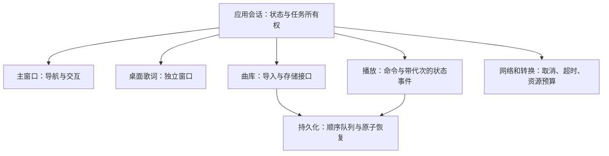

# 2026-11-05 — Resonance 稳定性重构边界与验收

适用基线：`0.6.6 / 40`，Android、Windows、Linux 原生播放器。官网保持独立。本文记录本次已完成的核心架构重构与平台验收边界；不把保留的 codec/协议/视觉接线说成全部重写，也不把测试通过等同于长期零故障。

## 决策

已重建应用任务、窗口、播放、导入/队列/歌词及存储之间的边界，继续使用 Kotlin / Compose 原生。目标是让故障能定位、能隔离、能回归，而不是以代码迁移量作为稳定性证明。

2026-11-05 桌面实例的证据：主窗口隐藏时，组合器有待处理更新；透明歌词窗已经存在但显示黑块；事件线程能响应诊断请求，未发现 Java monitor 死锁；音频解码线程另有持续高 CPU。这些事实不足以证明 Kotlin 语言是原因，也不足以将两个异常归为同一个故障。诊断文件保存在忽略目录 `build/desktop-lyrics-stability-2026-11-05/`，屏幕图像不提交。

## 语言与框架选择

| 路线 | 可用性和代价 | 当前决定 |
| --- | --- | --- |
| Kotlin / Compose 原生、分层重构 | 保留 Android Media3、现有转换、包兼容和已覆盖的并发保护；需要修正窗口生命周期和桌面输出问题 | 优先实施，逐项以真实平台验收 |
| C++ / Qt 桌面，Android 保留 Kotlin | Qt 官方支持 Windows/Linux，提供音频和窗口能力；需重写桌面 UI、桥接原业务并重新验证所有平台行为，C++ 的所有权/并发也需工程约束 | 如现有桌面渲染无法满足验收，再做隔离原型；未选型、未迁移 |
| Dart / Flutter 三端重写 | 官方支持 Android、Windows 和 Linux；现有 Media3 后台播放、悬浮权限、转换及文件兼容仍需重新桥接和验证 | 不因“换语言”直接采用；未选型、未迁移 |
| 新增 Rust 核心 | 可用于明确边界的解码或文件处理，但引入 FFI、打包和错误传递成本；无法自动修复窗口生命周期或消除死锁 | 有可测收益和独立接口后再评估 |

平台支持只证明框架可以部署，不能证明 Resonance 的功能、性能或数据迁移已经可靠。以上成本判断是结合当前源码的工程评估。

官方依据（2026-11-05 查阅）：[Compose 顶层窗口](https://kotlinlang.org/docs/multiplatform/compose-desktop-top-level-windows-management.html)、[Qt 平台支持](https://doc.qt.io/qt-6/supported-platforms.html)、[Qt Multimedia](https://doc.qt.io/qt-6/qtmultimedia-index.html)、[Flutter 平台支持](https://docs.flutter.dev/reference/supported-platforms)。

## 目标边界

窗口边界已实施，Linux 歌词小窗采用不透明表面。随后完成 application 用例/生命周期、平台能力和桌面音频输出重构；完整源编译、共享/桌面回归、当前包与设备结果见[本轮记录](changes/2026-11-05-07-application-core-and-desktop-audio-refactor.md)。前轮窗口诊断保留在[历史记录](changes/2026-11-05-06-desktop-lyrics-window-and-stability-boundaries.md)。

应用会话不依赖主窗口是否显示；歌词窗不由主窗口的重绘来驱动。窗口只呈现状态并提交命令。播放任务携带代次，旧任务不能覆盖新歌曲。存储保持单写入顺序、原子替换和备份恢复。耗时工作不在 UI 线程执行，取消与失败要有明确归属。

## 实施顺序与完成条件

| 阶段 | 改动 | 验收条件 | 状态 |
| --- | --- | --- | --- |
| 1. 窗口与会话分离 | App 在 application 层持有应用会话，主窗/歌词窗同级；Linux 使用不透明歌词表面 | 隐藏主窗仍能更新/操作歌词，关闭/恢复有界 | 已实施；最终原生生命周期回归通过。真实屏幕/当前安装见本轮记录；Windows 系统显示路径待验收 |
| 2. 桌面播放输出边界 | 可注入 FFmpeg/JavaSound 后端、请求会话、有限 worker/设备槽、零写入退让和无进展错误 | 暂停中途写入、快速切换、阻塞清理、首 PCM 缓冲、真实输出 | 已实施；6 项会话测试及真实 FFmpeg/JavaSound 回归通过。驱动永久阻塞、设备拔插/蓝牙和长时验收待补 |
| 3. 状态与业务用例 | ApplicationTasks/Lifetime、PlaybackSession、LyricsSession、LibraryImportUseCase、ApplicationPreferences；五类平台能力，桌面扫描/存储/播放适配分文件 | 用例不依赖窗口显示；迟到结果失效；导入反映提交结果；退出先取消并等待生产者 | 已实施；共享/桌面全套 388 通过/8 条件跳过，最终退出补充 55 项通过；保留 App 的 UI/翻译/补全接线 |
| 4. 存储收口 | 配置/天气共用顺序写入机制；关闭可等待；统计内存快照与 IO 加载；原 Store/原子备份保留 | 操作顺序、取消清理中的最后保存、磁盘失败、旧数据/备份、统计读取不等待磁盘锁 | 已实施；队列、用例、统计和原有数据兼容回归通过；未迁移格式/删除音频 |
| 5. 平台与发布门槛 | 两平台完整主源码编译及 Android 设备测试源码编译；完整包/隔离设备/本机更新 | 当前源对应实际包；隔离验收和日常安装分开，保留回滚 | Android 独立包三轮重建/关闭与 Linux 隔离实屏/完整安装通过；Windows 实机/正式 Release/长时与全功能真实曲库验收未完成，未公开发布 |

跨进程播放可以提高故障隔离，但也增加 IPC、进程重启、音频焦点与状态恢复的复杂度。先建立进程内清晰边界和失败验收，再决定是否拆进程，不一次性引入多进程与数据格式迁移。

## 验收与安全边界

窗口阶段与本轮紧密关联的核心重构分别保留独立变更记录，区分通过、失败、未执行和环境受阻。一次通过不是“永不出错”的承诺。界面启动、歌词文本算法、离屏渲染、原生窗口交互、真实屏幕输出和长时稳定运行是不同证据。

不批量删除旧实现，不重写用户歌曲，不自动迁移或清空曲库，不自动升版。新旧行为通过隔离夹具对照，正常退出时排空已接收的写入。当前共享 Linux 构建始终服从 [本机资源预算](AI-WORKFLOW.md#本机资源预算)。

## 当前源码入口（2026-11-05）

- `commonMain/application/`：任务与退出事务、捕获值偏好写入、导入、队列和歌词用例。App 为装配与 UI state bridge，单一 Gradle 模块不变。
- `commonMain/platform/*Services`：五个职责接口，由 PlatformServices 聚合兼容；所有 Android/桌面调用方须一起重编译，不能将旧默认参数 helper 与新接口混装。
- `desktopMain/audio/DesktopAudioBackend.kt`：解码进程/PCM 输出接口及真实后端；`DesktopPcmPlayer` 持有会话、缓存位置、有限输出循环。
- `desktopMain/platform/DesktopMusicScanner.kt`、`DesktopLibraryStore.kt`、`DesktopAudioPlayer.kt`：从大平台文件提取；转换、校验、原子存储机制继续复用。
- `jvmMain/playback/ListeningStatsRepository`：IO 写入器与内存 StateFlow；UI 通过 `ListeningStatsState` 观察。

正常退出先拒绝新工作，取消并等待生产者清理，再排空各写入器，最后释放平台。任务与写入器不是同一个可取消作用域，避免退出取消导致已接收写入丢失。该流程和异常路径由 ApplicationSessionTest 等回归约束。
